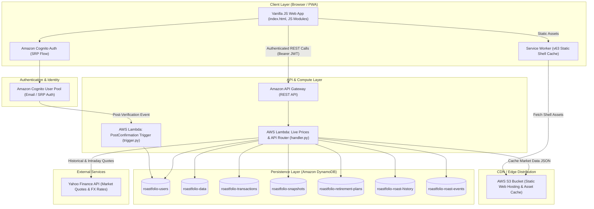
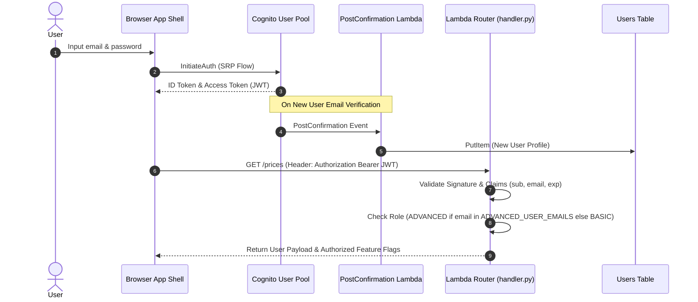
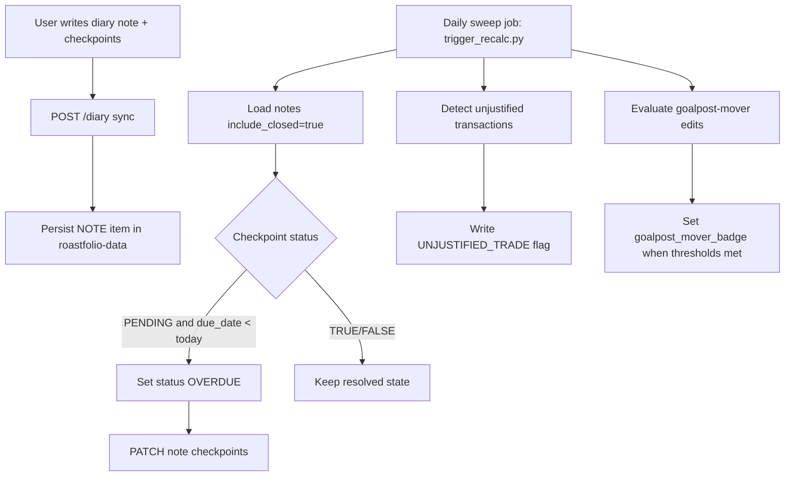

# Roastfolio — Technical Architecture & System Reference

## 1. System Overview & Infrastructure Architecture

### Wallets UI 20

The Wallets screen shares the dashboard's v9 tokens and frameless layout.
`src/scripts/manage.js` retains the existing wallet selection, ledger operations,
search, benchmark and ATH handlers. The view adds a value/performance hero,
allocation bar and legend, Active/Cemetery holdings tabs, and an inline settings
rail. All wallets is a combined read-only view; trades require a specific wallet.
Transactions use the existing form in a desktop side sheet or phone bottom sheet.
Responsive styles live under `#tab-wallets` in `src/styles/ui20.css`.
The settings rail shows the account benchmark, with Change opening User settings
(the benchmark is account-wide). It also shows the current ATH. Set ATH manually
and Rename wallet have separate Save buttons (`saveWalletAth`, `saveWalletName`).
The legacy wallet-settings modal has been removed.

Annual return is XIRR as a fraction, formatted as a percentage. When Newton's
method steps below -100%, `calculate_xirr` (and the dev server's `_xirr`) fall
back to bisection on [-0.9999, 10] instead of returning the -0.9999 floor.

The approved reference is `design/mockups/wallets.html`; decisions D-035 through
D-040 and Appendix B in `DESIGN_SYSTEM_2026_V9.md` define its design contract.
`tests/test_ui20_wallets_browser.py` covers the real screen alongside the mockup
and existing transaction contract suites.

### History UI 20

The History screen now uses the same v9 token and frameless layout primitives as
Dashboard and Wallets. `src/index.html` keeps the public History entry points but
restructures Overview into a UI 20 segmented section switcher, wallet chips,
range control, value hero, merged return chart, and a two-column monthly/daily
analysis pair. `src/scripts/chart.js` still owns the existing snapshot loading and
public functions (`setHistorySection`, `setHistoryRange`, `setHistoryWallet`,
`setHistoryReturnMode`, `setHistoryMonthlyMetric`, `renderHistoryTab`). It now
also populates the hero facts, overlays benchmark series in percentage return
mode, hides benchmark chips in PLN mode, and renders daily changes as one scatter
chart with best/worst halos and an average line.

Summaries continue to use the monthly wrap payload generated by
`lambda/wrap_generator.py`. `src/scripts/monthly-audit.js` replaces the old select
toolbar with a Monthly/Yearly period navigator (Yearly is disabled until annual
wraps exist), renders the recap poster from real wrap fields, adds the three
numbers strip, keeps the seven existing data chapters, and ends with the
privacy-first share invite. `src/scripts/monthly-audit-share.js` is the shared
headline and poster-image model: it prefers benchmark gap plus carry/anchor
contribution, then ATH, then the existing sign-based fallback. The invite's
Download image action opens the existing local share dialog and triggers its PNG
download path; nothing is uploaded.

Browser coverage lives in `tests/test_ui20_history_browser.py`, with existing
monthly audit browser/contract tests updated for the new navigator, poster, and
headline contract.

### Dashboard performance measurements

`src/scripts/dashboard-performance.js` starts before dashboard scripts and stores
numeric timings for the last 20 page loads in this browser only. In User settings,
**Dashboard performance > Export timings** downloads JSON; **Clear timings** removes
the saved history. Nothing is uploaded automatically, and account IDs, tokens,
holding names, prices, return series, and request URLs are not recorded.

Measurements include:

- Time since navigation to bootstrap, cached display, lite/full readiness, and
  intraday readiness. Live readiness means two animation frames after synchronous
  rendering, not completion of the decorative gauge animation.
- API time to response headers (network, server work and any Lambda cold start),
  remaining response-body read, JSON parsing, data application and dashboard
  rendering. `data-apply` includes synchronous event listeners, so it overlaps
  intraday rendering: these durations must not be summed as independent phases.
- Intraday synthesis and total intraday rendering, including synthesis.
- First contentful paint, latest largest contentful paint, supported long tasks,
  navigation TTFB, viewport and static asset transfer/decoded sizes.
- `/prices` exposes `Server-Timing: app;dur=...` (handler time, excluding platform
  cold-start initialization) and `X-Response-Bytes` (uncompressed UTF-8 JSON bytes).
  CloudWatch retains API aggregate dimensions and additionally separates
  `lite/full/history` views, with a `ColdStart` log field. A missing browser metric
  is unavailable, not evidence of zero time or zero bytes.

### API concurrency guard

Lambda concurrency in the AWS account (us-west-2) is a single pool shared by dev
and prod. When it is exhausted, Lambda throttles the invocation and API Gateway
answers with a generic `500 {"message":"Internal server error"}` that never
reaches the function logs. `src/scripts/api-throttle.js` loads before every
script that calls the API and wraps `window.fetch` for API Gateway origins only:
it allows at most 6 API requests at a time and retries `GET`/`HEAD` up to three
times (about 0.6 s, 1.5 s and 3.5 s plus jitter) on 429, 502, 503, 504 or that
specific gateway 500. Application errors (`{"error": ...}`) and non-idempotent
methods are never retried. The account limit was raised from 10 via a Service
Quotas request (L-B99A9384); diagnose suspected throttling with the AWS/Lambda
`Throttles` and AWS/ApiGateway `5XXError` metrics.

Read current data from `DashboardPerformance.snapshot()` in browser developer
tools. LCP/long-task values can continue to change as the user interacts; compare
equivalent checkpoints and visible foreground sessions. Cross-origin resource
sizes may be unavailable unless Timing-Allow-Origin is supplied; explicit server
headers do not depend on that browser permission.

Repeatable synthetic benchmark (requires existing Playwright/Chromium test setup):

```sh
.venv/bin/python scripts/benchmark_dashboard.py --baseline 50425ee --runs 7 --output /tmp/dashboard-desktop.json
.venv/bin/python scripts/benchmark_dashboard.py --baseline 50425ee --runs 7 --cpu-rate 4 --output /tmp/dashboard-slow-cpu.json
```

The benchmark compares the pre-UI-20 git baseline, the current dashboard without
the comparison controller (same larger payload), and the complete current
dashboard. It uses 15 synthetic stocks plus cash, fixed API delay, simulated
10 Mbps **uncompressed API-body transfer**, cached identical CDN scripts, fresh
contexts without service workers, alternating run order and one discarded warm-up
per variant. Git baseline files are served from memory without changing branches.
Raw samples, medians, empirical p95, fixture byte counts and gzip estimates are
written to JSON. With seven samples, p95 is effectively the slowest sample, not a
reliable production tail-latency estimate. Synthetic fixtures do not measure real
Yahoo latency, Lambda initialization, AWS cache state, or user-specific network
conditions. Gzip sizes are estimates only; the current dev API had compression
disabled when inspected on 2026-10-15.

### Dashboard intraday comparison

The dashboard synthesizes portfolio returns in the browser from the existing full
`/prices` holdings payload and benchmark minute candles. No intraday snapshots,
database tables, scheduled jobs, or additional holdings-price requests are used.
`src/scripts/intraday-comparison.js` owns the pure calculation and Chart.js view.

- Both curves use the selected benchmark's session-open baseline. WIG sessions
  use 09:00-17:00 in `Europe/Warsaw`; exchange-local time zones handle DST.
  Provider session metadata can shorten a scheduled session for early closure.
  Without metadata the UI explicitly identifies the scheduled closing time.
- The user-scoped browser preference selects benchmark-session hours or the
  benchmark-local calendar day (00:00-24:00). In the latter view, portfolio points
  still begin at benchmark open and continue through the current minute, carrying
  forward the latest known prices with freshness warnings. The benchmark stops
  at its last available candle or session close, whichever comes first.
- Candle timestamps remain unchanged. Since Yahoo timestamps identify candle
  starts, closing prices become available one minute later; the opening price is
  the initial baseline. Current quotes are not substituted for historical candles.
- Each stock includes `intradayBaseline` (`openTime` and exchange `sessionStart`
  in epoch milliseconds, `openPrice`, `previousClose`) and an unrounded
  `intradayFxRate`. Before another market opens, its previous close is carried
  forward only when its later exchange opening is verified. A known price at/before
  the shared baseline is otherwise required. Missing holdings are never excluded
  and the remaining holdings are never renormalized.
- Holdings fetch two days of minute candles in the same history request and send
  them as `comparisonBars`, so an instrument-local midnight does not discard the
  shared session baseline. `todayBars` still contains only the latest instrument
  date for Today's Movers. This adds payload history, not another API call.
- The chart baseline is the benchmark session open, while the dashboard gauge
  measures from the previous close (including FX moves). Overnight gaps therefore
  appear in the gauge but not the chart; an info button (ⓘ) next to the chart title
  explains this in a tooltip (hover, focus or tap; Escape or an outside tap closes it).
- Yahoo exchange quotes (benchmark and holdings) are 15 minutes late, so both
  lines stop at now − 15 minutes (`QUOTE_DELAY`); otherwise the portfolio line
  would run flat through the last 15 minutes. Until 15 minutes after the open
  the chart says when it will start, and the status line notes the delay.
- Cash and units are fixed at the current payload values; PLN conversion uses
  constant FX throughout the curve. The benchmark stays in its native currency.
  This is a reconstruction for the current composition, not transaction-aware
  account performance or an exact reproduction of the FX-inclusive daily metric.
- Sparse prices are carried forward, with old observations disclosed. Index
  feeds often publish their first value a minute or two after the open (Yahoo's
  WIG starts at 09:01), so the first benchmark print within 15 minutes of the
  open is used as its opening level, disclosed, and the benchmark line starts
  there. Later or missing opening data and missing valuation inputs produce
  visible unavailable states.
  Holidays/weekends show the latest supplied benchmark session with its date,
  rather than fabricating a new session. Minute resolution is not a guarantee of
  minute freshness: holdings bars may be cached for up to three minutes and the
  view refreshes when the existing full price payload arrives.

Validation: `tests/test_intraday_comparison_browser.py` exercises the calculation,
session boundaries, DST, missing-data handling, saved window setting and tooltips.
`tests/test_intraday_prices.py` checks timestamp preservation and valuation metadata.

Roastfolio (Emerytura Investment Dashboard) is a high-performance, serverless financial portfolio analytics and tracking platform. The application provides real-time market data, historical valuation snapshots, AVCO (Average Cost) accounting, gamified analytics, FIRE retirement forecasting, and sarcastic market commentary.

### High-Level Architecture Diagram



---


### Dashboard hero, header and ATH widgets (UI 20)

- Header: one left-aligned layout at every width — (menu button on phones,)
  screen name and live chip in the first row, market comment below. The logo and
  "roastfolio" wordmark live only in the side navigation.
- Phones (≤767px): the roast and the gauge sit side by side, the total value
  spans underneath. The gauge canvas takes its height from its wrapper
  (220px desktop, 170px tablet, 112px phone) so it is never stretched.
- "Under the surface" (`renderAthLake`): the dashed line is the ATH. Distance
  uses a log scale (`log10(1 + 10·|d|)`, 50% drawdown or +20% gain at full
  height) so small drawdowns stay visible. Below the ATH the gap fills red and
  bubbles rise; above it a green tide rises with sparks. Labels sit on opposite
  sides of their lines so they never overlap.
- New-ATH banner (`athBreakoutMarkup`): a sparkline breaks through the dashed
  previous-peak ceiling, the new high pulses and throws sparks. It is rebuilt
  only when the record changes, so live refreshes do not replay it. Wallet
  carousel slides keep the older `athCelebrationMarkup`.

## 2. Database Schema & Data Models

Roastfolio uses Amazon DynamoDB (Pay-Per-Request / On-Demand) organized with single-table design patterns for core entity groups alongside dedicated tables for high-throughput ledgers and temporal snapshot series.

### Table Schema Summary

| Table Name | Primary Key (`PK` / `HASH`) | Sort Key (`SK` / `RANGE`) | Description | Secondary Indexes (GSIs) |
| :--- | :--- | :--- | :--- | :--- |
| `roastfolio-users` | `userId` (String UUID) | *None* | User profile metadata, settings, subscription tier | `email-index` (`email` -> `userId`, `nickname`) |
| `roastfolio-data` | `userId` (String UUID) | `sk` (String) | Single-table: Portfolios (`PORTFOLIO#<pid>`), Holdings (`HOLDING#<pid>#<id>`), AVCO (`AVCO#<pid>`) | *None* |
| `roastfolio-transactions` | `userId` (String UUID) | `sk` (`PORTFOLIO#<pid>#TX#<YYYY-MM-DD>#<txId>`) | Chronological trade ledger for asset & cash transactions | *None* |
| `roastfolio-snapshots` | `userId` (String UUID) | `sk` (`PORTFOLIO#<pid>#SNAPSHOT#<YYYY-MM-DD>`) | Historical daily valuation snapshots, ATH records (`...#ATH`) | *None* |
| `roastfolio-retirement-plans`| `userId` (String UUID) | `sk` (`PLAN#<planId>`) | FIRE retirement plans and saved Monte Carlo forecast results | *None* |
| `roastfolio-roast-history` | `userId` (String UUID) | `createdAt` (String ISO-8601) | Sarcastic roast history logs with TTL expiration | TTL on `expiresAt` |
| `roastfolio-roast-events` | `templateId` (String) | `createdAt` (String ISO-8601) | Global commentary template triggering telemetry | `user-events-index` (`userId`, `createdAt`) |

---

### Detailed Key Schemes & Item Layouts

#### 1. `roastfolio-data` (Portfolios & Holdings)
- **Portfolio Item**:
  - `PK`: `<userId>`
  - `SK`: `PORTFOLIO#<portfolioId>`
  - Attributes: `portfolioId`, `name`, `type` (`"real"`), `currency` (`"PLN"` \| `"USD"` \| `"EUR"`), `color`, `order`, `createdAt`, `updatedAt`
- **Holding Item**:
  - `PK`: `<userId>`
  - `SK`: `HOLDING#<portfolioId>#<holdingId>`
  - Attributes: `portfolioId`, `holdingId`, `name`, `ticker` (e.g., `"XTB.WA"`, `null` for cash), `currency`, `units` (Decimal), `purchaseValue` (Decimal cost basis in PLN), `updatedAt`

#### 2. `roastfolio-transactions` (Trade Ledger)
- `PK`: `<userId>`
- `SK`: `PORTFOLIO#<portfolioId>#TX#<YYYY-MM-DD>#<transactionId>`
- Attributes: `transactionId`, `portfolioId`, `holdingId`, `type` (`"BUY"` \| `"SELL"` \| `"DIVIDEND"` \| `"SPINOFF"` \| `"DEPOSIT"` \| `"WITHDRAWAL"` \| `"EXTRA_COST"` \| `"CASH_ADJUSTMENT"`), `ticker`, `name`, `currency`, `quantity`, `price`, `value`, `commission`, `tax`, `comment`, `transactionDate`, `createdAt`, `updatedAt`

#### 3. `roastfolio-snapshots` (Historical Daily Valuation)
- `PK`: `<userId>`
- `SK`: `PORTFOLIO#<portfolioId>#SNAPSHOT#<YYYY-MM-DD>`
- Attributes:
  - `snapshotDate`: `"YYYY-MM-DD"`
  - `totalValuePLN`: Net portfolio value in PLN
  - `costBasisPLN`: Total invested capital / cost basis in PLN
  - `unrealizedPLN`: `totalValuePLN - costBasisPLN`
  - `unrealizedPct`: Percentage gain/loss
  - `dailyChangePLN`: 1-day absolute PLN change
  - `dailyChangePct`: 1-day percentage change
  - `xirr`: Annualized internal rate of return percentage
  - `holdings`: Map of historical holding snapshots (`units`, `pricePLN`, `valuePLN`)

#### 4. `roastfolio-data` (Coping Diary Notes & Behavioral Flags)
- **Diary Note Item**:
    - `PK`: `USER#<userId>`
    - `SK`: `NOTE#<noteId>`
    - Attributes: `note_id`, `note_text`, `linked_assets`, `hypothesis`, `hypothesis_checkpoints`, `user_tags`, `is_closed`, `goalpost_change_count`, `goalpost_change_events`, `goalpost_mover_badge`, `timestamp`, `createdAt`, `updatedAt`
- **Hypothesis Checkpoint Schema** (`hypothesis_checkpoints[]`):
    - `checkpoint_id`: Stable checkpoint UUID
    - `text`: Falsifiable statement text
    - `due_date`: Date string (`YYYY-MM-DD`)
    - `status`: `PENDING` | `OVERDUE` | `TRUE` | `FALSE`
    - `resolved_at`: ISO timestamp for TRUE/FALSE resolutions, `null` otherwise
- **Behavioral Flag Item**:
    - `PK`: `USER#<userId>`
    - `SK`: `UNJUSTIFIED_TRADE#<portfolioId>#<ticker>#<YYYY-MM-DD>#<txId>` (and analogous keys for other flag families such as hypothesis audit reminders)
    - Attributes: `type`, `active`, `portfolio_id`, `ticker`, `transaction_id`, `date`, `reason`, `createdAt`

---

## 3. Subsystems & Data Flows

### A. Authentication & Role Authorization



- **Feature Gating**: Role is assigned dynamically based on environment configuration (`ADVANCED_USER_EMAILS`). BASIC users receive locked UI tab access for advanced ledger features, while ADVANCED users receive full raw transaction ledger controls.

---

### B. Transaction Ingestion & AVCO Analytics Engine

The AVCO (Average Cost Basis) engine processes chronological asset transactions to calculate current position cost basis, realized gains, spinoff adjustments, wash-sale violations, and sarcastic bagholder badges.

```mermaid
flowchart TD
    A[Save/Update Transaction API] --> B{Valid Payload?}
    B -- No --> C[Return 400 Error]
    B -- Yes --> D[Derive holdingId from Ticker/Name]
    D --> E[DynamoDB TransactWriteItems: Write TX Item]
    E --> F[Rebuild Holdings from Ledger]
    F --> G[Replay Chronological Transactions in AVCO Engine]
    
    subgraph AVCO ["PortfolioAVCOCalculator"]
        G --> H{Transaction Type}
        H -- BUY / SPINOFF --> I[Update Position Units & Weighted AVCO Price]
        H -- SELL --> J[Calculate Realized Gain = Units * (SellPrice - AVCO)]
        J --> K[Check Wash-Sale: Loss sale rebuy within 30 days]
        H -- DIVIDEND --> L[Add to Received Dividends]
    end

    AVCO --> M[Persist AVCO#portfolioId in roastfolio-data]
    M --> N[Trigger Snapshot Recalculation from Transaction Date]
```

#### AVCO Position Badge Logic
- **Clown Bagholder**: Active value `< 10 PLN` with historical peak value `> 250 PLN` following a major loss sale (`<= -20%`).
- **Paper Hands FOMO**: Position closed with minor gain (`< 5%`), followed by market rally where asset price rose `>= +30%` post-closure.
- **Wash Sale Violator**: Re-bought asset within 30 days after realizing a loss sale.

---

### C. Historical Snapshot & Snapshot Recalculation Engine

The snapshot calculation engine constructs daily historical portfolio valuations for performance charts, sparklines, and XIRR rate-of-return calculations.

```mermaid
flowchart LR
    A[recalculate_portfolio_snapshots_from_date] --> B[Fetch All Chronological Ledger Transactions]
    B --> C[Query Historical Price Data Range via YFinance]
    C --> D[Apply 14-Day Lookback Window for Market Close Prices]
    
    D --> E{Asset Ticker?}
    E -- GPW stock (*.WA) --> F[Resolve Currency = PLN (Prevent Double FX)]
    E -- Foreign Stock/ETF --> G[Apply USD/EUR FX Rate]
    E -- Foreign Cash --> H[Apply Historical FX Conversion]
    
    F & G & H --> I[Compute Daily Net Asset Value & Cost Basis]
    I --> J[Calculate 1-Day Daily Change & XIRR]
    J --> K[Batch Write Snapshot Items to roastfolio-snapshots]
```

#### Critical Robustness Guarantees:
1. **14-Day Lookback Buffer**: Market price lookups incorporate a 14-day preceding lookback window. Non-trading days (weekends, market holidays) resolve to the last available trading close price instead of returning `None` (preventing artificial portfolio value collapses on weekends).
2. **Market Currency Resolution**: Polish GPW equities (`.WA`) explicitly map to `PLN`, preventing double FX currency conversion when holding or portfolio default currency is set to USD or EUR.
3. **Graceful AVCO Oversell Clamping**: If legacy transaction ledgers contain minor floating-point oversell discrepancies, `_process_sell` clamps sold units to available active units without failing snapshot batch writes.

---

### D. Live Data & Performance Caching Strategy

To deliver instant PWA load times, Roastfolio employs a dual-stage fetch architecture alongside Service Worker shell caching:

1. **Lite View (`GET /prices?view=lite`)**:
   - Returns cached holding balances, latest snapshot values, and gauge metrics.
   - Executes in `< 50ms`.
2. **Full View Background Prefetch (`GET /prices?view=full`)**:
   - Triggered asynchronously in the background.
   - Fetches live YFinance market prices, intraday benchmark changes (`^GSPC`, `WIG.WA`), ticker carousel data, and updates S3 cache buckets.
3. **Service Worker (`src/service-worker.js` - Cache Version `roastfolio-v63`)**:
   - **Shell-First Strategy**: HTML, CSS, JavaScript modules, and app icons are served instantly from cache, revalidated in background.
   - **Never-Cache Rules**: API endpoints (`/lambda/`, `amazonaws.com`) and authentication calls bypass SW cache for live execution.

---

### E. Coping Diary Checkpoint Automation & Audit Flow

The Coping Diary subsystem combines user-authored thesis notes with automated daily behavioral checks.



#### Sweep Responsibilities (`lambda/trigger_recalc.py`)
- Recalculate portfolio and summary snapshots.
- Mark overdue hypothesis checkpoints (`PENDING` to `OVERDUE`).
- Detect and write `UNJUSTIFIED_TRADE` reminder flags.
- Apply `#Coping` auto-tag in severe drawdown contexts.
- Award `goalpost_mover_badge` for repeated retroactive edits to risk/exit thesis fields under drawdown conditions.

#### Frontend Audit UX (`src/index.html`)
- `HYPOTHESIS_AUDIT` toast click opens Coping Diary, selects target note, and launches a dedicated modal.
- Modal action `YES, TRUE` resolves checkpoint as TRUE.
- Modal action `NO, FALSE` resolves checkpoint as FALSE, auto-adds `#Coping`, re-prioritizes note to the top of the ledger, and marks failed thesis metadata for monthly roast reporting.

---

## 4. API Endpoint Directory

All endpoints are hosted on Amazon API Gateway and routed via `lambda/handler.py`. Requests require a valid `Authorization: Bearer <ID_TOKEN>` header (except CORS preflight `OPTIONS`).

### Portfolios & Ledger Endpoints

| Method | Endpoint Path | Description | Authorization |
| :--- | :--- | :--- | :--- |
| `GET` | `/prices` | Get portfolio data, holdings, main gauge, live market prices | Bearer JWT |
| `GET` | `/portfolios` | List all user portfolios | Bearer JWT |
| `POST` | `/portfolios` | Create a new portfolio wallet | Bearer JWT |
| `PUT` | `/portfolios/{id}` | Update portfolio settings (name, color, order) | Bearer JWT |
| `DELETE`| `/portfolios/{id}` | Delete portfolio and associated holdings/snapshots | Bearer JWT |
| `GET` | `/portfolios/{id}/transactions` | List portfolio transactions | Bearer JWT |
| `POST` | `/portfolios/{id}/transactions` | Record a new transaction | Bearer JWT |
| `PUT` | `/portfolios/{id}/transactions/{txId}` | Update an existing transaction | Bearer JWT |
| `DELETE`| `/portfolios/{id}/transactions/{txId}` | Delete a transaction | Bearer JWT |

### Snapshots & Analytics Endpoints

| Method | Endpoint Path | Description | Authorization |
| :--- | :--- | :--- | :--- |
| `GET` | `/portfolios/{id}/snapshots` | Retrieve daily portfolio snapshot series | Bearer JWT |
| `POST` | `/portfolios/{id}/snapshots/recalculate` | Trigger snapshot recalculation from specified date | Bearer JWT |
| `GET` | `/portfolios/{id}/avco` | Get AVCO analytics, positions, realized returns, badges | Bearer JWT |
| `GET` | `/portfolios/{id}/ath` | Get All-Time-High celebration data and history | Bearer JWT |

### FIRE & Retirement Plan Endpoints

| Method | Endpoint Path | Description | Authorization |
| :--- | :--- | :--- | :--- |
| `GET` | `/retirement-plans` | List user retirement plans | Bearer JWT |
| `PUT` | `/retirement-plans` | Save retirement plan parameters | Bearer JWT |
| `POST` | `/retirement-plans/{id}/simulate` | Run Monte Carlo retirement simulation | Bearer JWT |

### Coping Diary & Behavioral Endpoints

| Method | Endpoint Path | Description | Authorization |
| :--- | :--- | :--- | :--- |
| `GET` | `/diary?includeClosed=true` | List diary notes for the current user | Bearer JWT |
| `POST` | `/diary` | Create/sync diary note payload (including checkpoints) | Bearer JWT |
| `PATCH` | `/diary/{noteId}` | Update an existing note (hypothesis, tags, checkpoints, close state) | Bearer JWT |
| `GET` | `/diary/flags?active=true&type=UNJUSTIFIED_TRADE` | Fetch active unjustified-trade reminders | Bearer JWT |
| `GET` | `/diary/flags?active=true&type=HYPOTHESIS_AUDIT` | Fetch due checkpoint audit reminders for modal flow | Bearer JWT |

---

## 5. CI/CD & Deployment Architecture

Deployments are managed via AWS SAM (Serverless Application Model) and CloudFormation templates (`template.yaml`).

### Deployment Environment Configuration

```mermaid
gitGraph
    commit id: "dev-init"
    branch test
    branch prod
    checkout dev
    commit id: "feat-avco-fix"
    checkout test
    merge dev id: "deploy-test-stack"
    checkout prod
    merge dev id: "deploy-prod-stack"
```

- **Branching Strategy**:
  - `dev`: Primary development branch.
  - `test`: Automated deployment to isolated `dev-roastfolio-*` stack via GitHub Actions (`deploy-test.yml`).
  - `prod`: Production deployment to live `roastfolio-*` infrastructure via GitHub Actions (`deploy-prod.yml`).
- **CloudFormation Resources Created**:
  - 1 AWS Lambda Function (`emerytura-live-prices`, Python 3.12 runtime, 512MB RAM, 60s timeout).
  - 1 AWS Lambda Cognito Trigger Function (`roastfolio-cognito-trigger`).
  - 7 Amazon DynamoDB Tables (`PAY_PER_REQUEST` billing with Point-In-Time Recovery enabled).
  - 1 Amazon Cognito User Pool & User Pool Client.
  - 1 Amazon API Gateway REST API with CORS enabled.
